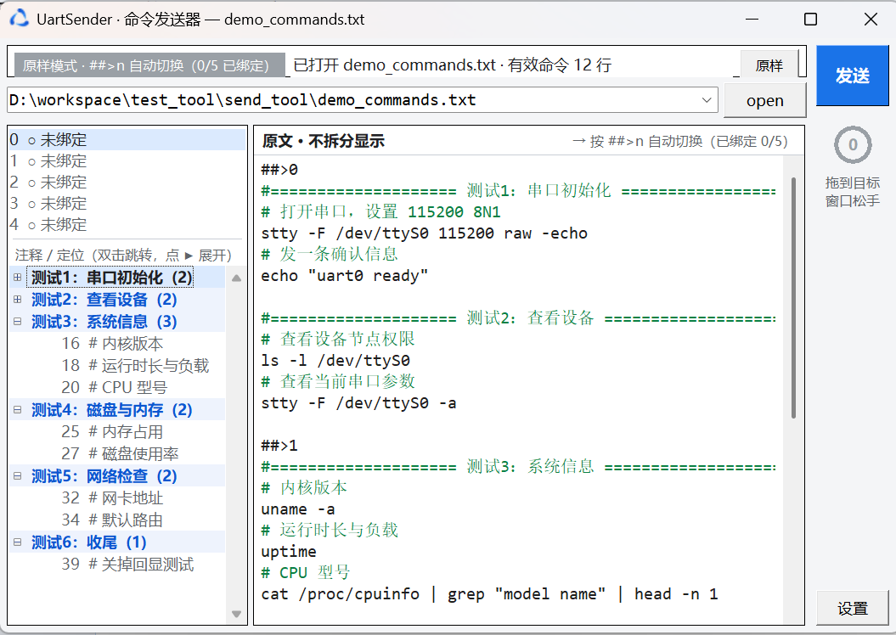
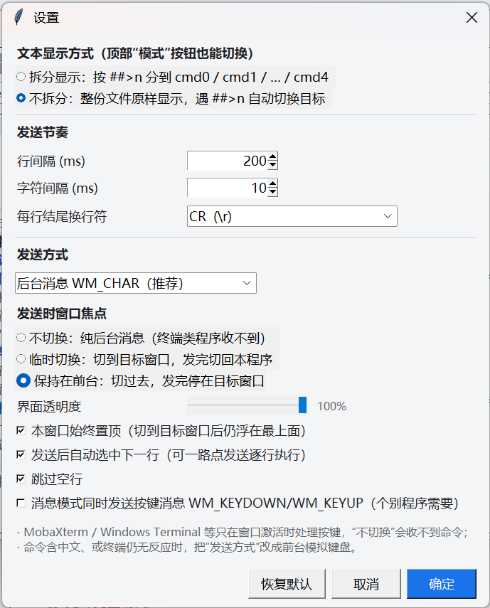

# UartSender · 命令发送器

把一份 txt 命令脚本，按行"敲"进其它 Windows 窗口（串口终端、SSH 终端、命令行窗口都行）。
纯 Python 标准库实现（`tkinter` + `ctypes`），无第三方依赖，可直接打包成绿色单文件 exe。



```
┌────────────────────────────────────────────────┬──────────┐
│ 原样模式 · 5/5 已绑定   状态提示…      [原样]   │  发送    │
├────────────────────────────────────────────────┤          │
│ [ C:\work\commands.txt ................. ▼] open │   (●)    │
├────────────┬───────────────────────────────────┤          │
│ 0 ● MobaX… │ 原文（不拆分）→ 按 ##>n 自动切换   │          │
│ 1 ● PuTTY  ├───────────────────────────────────┤          │
│ 2 ● WT     │ cmd 0 …                           │   设置   │
│ 3 ○ 未绑定 ├───────────────────────────────────┤          │
│ 4 ● 串口…  │ cmd 1 …                           │          │
├────────────┤───────────────────────────────────┤          │
│ ▾ 测试1 (2)│ cmd 2 …                           │          │
│   ▾ 测试2  │ cmd 3 …                           │          │
└────────────┴───────────────────────────────────┴──────────┘
```

**5 个通道**（uart0~uart4 / cmd0~cmd4），左侧只显示通道号 `0~4`，把位置留给窗口标题。
两个显示模式（顶部右侧 **[拆分]/[原样]** 按钮随时切换，**默认原样**）：

| 原样显示（默认） | 拆分显示 |
| --- | --- |
|  |  |
| 整份文件一栏原样显示，发送时遇 `##>n` 自动切换目标窗口 | 按 `##>n` 拆到 cmd0~cmd4，每栏各自绑定一个 uart |

---

## 1. 运行环境

| 项目 | 说明 |
| --- | --- |
| 系统 | Windows 7/10/11（发送功能依赖 Win32 API；在 Linux/macOS 上只能看界面，不能发送） |
| Python | 3.8+，自带 `tkinter` 即可，**不需要 pywin32** |

### 直接跑源码

```bat
python main.py                 :: 打开空界面
python main.py demo_commands.txt   :: 打开时顺带加载文件
```

### 打包成 Windows 可执行文件

双击 `build.bat` 即可（自动装 PyInstaller 并打包），产物：

```
dist\UartSender.exe      ← 单文件绿色版，双击即用，可拷给同事
```

手工打包等价命令：

```bat
pip install pyinstaller
pyinstaller --noconfirm --clean --onefile --windowed --name UartSender ^
    --icon app.ico --add-data "app.ico;." main.py
```

> * `--windowed` 表示不弹黑框控制台；如果要看崩溃日志，去掉它再打一次包。
> * `--icon` 把图标**编译进 exe 资源**（资源管理器里看到的文件图标，拷到哪都不会丢）；
> * `--add-data` 让程序运行时也能读到 `app.ico` 文件。**这一项现在可以不写**——
>   程序找不到图标文件时会直接从 exe 资源里取，见下面"图标问题"。

---

## 2. 界面与操作

### 2.1 打开 / 编辑 / 保存

* **open**：选择 txt 文件，内容按 `##>n` 指令自动分派到 cmd0 / cmd1 / cmd2 三个编辑框；
  完整路径显示在旁边的 `txt_path` 输入框。
* **最近访问**：点 `txt_path` 右边的 **▼** 可以直接下拉选最近打开的 **10 个文件**（最近的排最上面），
  选中即打开；也可以在框里粘贴路径后回车。右键输入框可以「清空最近访问列表」。
* 编辑框支持选中、删除、撤销（Ctrl+Z）、全选（Ctrl+A）、复制粘贴。
* **保存**：`Ctrl+S` 覆盖保存，`Ctrl+Shift+S` 另存为；标题栏出现 `*` 表示有未保存修改，关闭时会提示。

### 2.1.1 两种显示模式（可用设置或右上角按钮切换）

| 模式 | 表现 | 发送行为 |
| --- | --- | --- |
| **拆分显示**（默认） | 按 `##>n` 把内容分到 cmd0 / cmd1 / cmd2 三栏 | 当前页（cmdN）→ 发给 uartN 绑定的窗口 |
| **不拆分 / 原样** | 整份文件原样显示在一栏里，`##>n` 行照样可见 | 顺序扫描，**执行到 `##>n` 行时自动切换到 uartN 的窗口** |

* 切换模式不会丢内容：拆分 → 原样 会自动补上 `##>n` 指令行，原样 → 拆分 会自动按指令重新分栏；
* 顶部状态栏右侧的按钮实时显示当前模式（`拆分` / `原样`），点一下即切换，设置里也能改。

### 2.2 绑定目标窗口（圆圈）

1. 先在左侧点选 `0 / 1 / 2 / 3 / 4`（双击也可以），它决定了要绑定哪个通道；
2. 按住右侧的**圆圈**往目标窗口上拖，拖到时会实时提示窗口标题；
3. 松开鼠标即完成绑定，圆圈变绿，标题写进 `uartN` 与 cmd 页右侧提示。

* 单击圆圈 = 查看当前槽位绑定情况；
* 右键圆圈 / 右键 uart 列表 = 从窗口列表里挑、或清除绑定；
* 每个 cmd 页对应同号通道（`cmd1` 的内容只发往 `1` 号窗口）；
* 左侧列表里 `●` = 已绑定（绿色），`○` = 未绑定（灰色），后面直接跟着完整窗口标题。

### 2.3 发送

| 操作 | 效果 |
| --- | --- |
| 光标停在某一行 → 点 **发送** | 只发这一行，**发完自动选中下一行** |
| 选中若干行 → 点 **发送** | 发送选中的行（按行发送，不会整段粘贴） |
| `Shift` + 点 **发送** / `Ctrl+Shift+Enter` | 发送当前 cmd 页（原样模式下发整份文本） |
| 右键 **发送** | 菜单里可以选"发送整个 cmdN / 整个文本"、开关「窗口始终置顶」、进设置 |
| 发送过程中按钮变 **停止** | 立即打断 |

* **逐行执行**：发完当前行/当前选中的几行后，选区会自动落到**下一条可发送的行**上（自动跳过空行、
  注释行、`##>n` 指令行），所以可以一直点"发送"把脚本按顺序跑下去；光标停在注释上时点发送，
  也会自动跳到下一条能发的命令再发出。可在设置里关掉「发送后自动选中下一行」；
* 注释行（`#` 开头）、`##>n` 指令行和空行默认不会发送；
* 每行结尾自动补换行符，默认 `CRLF`，可在设置里改（`CR` / `LF` / 不发送）；
* **原样模式**下：从光标/选区所在位置起逐行扫描，遇到 `##>n` 就把后续行发给 `uartn`
  的窗口，多段连发时会自动激活并切换窗口；有目标没绑定会先提示，不会发一半。

### 2.4 设置（右下角"设置"按钮）



| 设置项 | 默认 | 说明 |
| --- | --- | --- |
| 文本显示方式 | 不拆分（原样） | `不拆分`（整份原样，`##>n` 自动切换目标）或 `拆分显示`（cmd0~cmd4 五栏） |
| 行间隔 (ms) | 200 | 两行之间等待多久，`0` 表示不等待 |
| 字符间隔 (ms) | 10 | 逐字符发送时每个字符之间等待多久 |
| 每行结尾换行符 | CRLF | 发给 Linux 串口命令行一般 `CR`/`LF` 都行，按目标程序习惯选 |
| 发送方式 | 后台消息 WM_CHAR | 往窗口投递字符；`前台模拟键盘` 用 SendInput 真实敲键，兼容性最好 |
| 发送时窗口焦点 | 保持在前台 | `不切换` / `临时切换（发完切回本程序）` / `保持在前台`，见下方说明 |
| 本窗口始终置顶 | **开** | 即使目标窗口被切到前台，本工具仍浮在最上面 |
| 界面透明度 | 100% | 30%~100%，拖动即时预览，方便一边看终端一边看进度 |
| 发送后自动选中下一行 | 开 | 发完把选区移到下一条可执行行，方便逐行点发 |
| 跳过空行 | 开 | 关掉后空行会单独发一个换行 |
| 附带 WM_KEYDOWN/KEYUP | 关 | 个别只认按键消息的程序打开它 |

**发送时窗口焦点**为什么必须选：

| 选项 | 行为 | 适用 |
| --- | --- | --- |
| 不切换 | 只往窗口投递 WM_CHAR，不动前台窗口 | 记事本等传统 Win32 程序；**MobaXterm / Windows Terminal / Qt 类终端会直接丢弃，收不到命令** |
| 临时切换 | 发送时把目标窗口切到前台，全部发完再切回本工具 | 想发完立刻回到工具里继续编辑时 |
| 保持在前台（默认） | 切过去就不再切回，停在目标窗口看执行结果 | 想盯着终端看命令一行行执行（配合「始终置顶」） |

**配置文件位置**：程序（或 exe）**同级目录下的 `UartSender.json`**，随程序一起拷走即可带走全部设置，
下次启动自动读取；里面同时保存最近访问的 10 个文件、显示模式、发送参数。
若同级目录不可写（例如装在 `C:\Program Files`），会自动退回 `%APPDATA%\UartSender\UartSender.json`。
旧版本存在 `%APPDATA%` 的配置会在首次运行时自动迁移过来。

### 2.5 注释定位（按 `#===` 分组，可展开/收起）

文件里以 `#` 开头的行会被提取到左下角"注释 / 定位"树（`##>n` 指令行不计入）：

* **分组标题**：形如 `#======测试1====`（`#` 后面跟**任意个** `=`）的行会成为一个小节标题，
  它下面的 `#` 注释都归到这一节里，标题后面显示条数 `(3)`；
* 每个标题左侧有 **▸ / ▾** 展开收起图标，点一下即可折叠/展开（折叠状态会记住，
  改文件重建列表后仍然保持）；
* **双击**任意一条注释 → 右侧文本跳到那一行并高亮 1.8 秒；双击小节标题 → 展开/收起；
* 列表前缀：原样模式是行号 `5`，拆分模式是 `1·5`（cmd1 的第 5 行）。

---

## 3. 文件格式

```text
##>0
# 打开串口并设置波特率          ← 注释，不发送，出现在左下角列表
stty -F /dev/ttyS0 115200 raw -echo
echo "uart0 ready"

##>1
# 第二个窗口
uname -a
```

| 写法 | 含义 |
| --- | --- |
| `##>n` （n = 0~4） | 之后的内容归入 `cmdn`，发送到 `n` 号窗口 |
| `#=== 标题 ===` | 注释分组标题，在左侧树里作为可折叠的小节 |
| `# ……` | 注释，不发送，只用于定位 |
| 其他 | 正常命令行，逐行发送 |

* 没有 `##>n` 指令的文件也能打开，全部内容进 cmd0；
* 只有 cmd0 有内容时保存不会加指令头，文件保持"干净"；
* 拆分模式保存时按 `##>0 / ##>1 / ##>2` 顺序回写，读入—保存可无损往返；
* 原样模式保存时按编辑框里的内容**原样写回**（`##>n` 行保留），同样无损。

---

## 4. 快捷键

| 快捷键 | 功能 |
| --- | --- |
| `Ctrl+O` | 打开文件 |
| `Ctrl+S` | 保存 |
| `Ctrl+Shift+S` | 另存为 |
| `Ctrl+Enter` | 发送选中行 / 光标所在行 |
| `Ctrl+Shift+Enter` | 发送整个 cmd 页 |
| `Ctrl+A` / `Ctrl+Z` / `Ctrl+C` `Ctrl+V` | 全选 / 撤销 / 复制粘贴 |

---

## 5. 常见问题

**MobaXterm / Windows Terminal 收不到命令？**
这类程序（Qt / 新式终端）只在窗口处于**激活状态**时才处理按键消息，
纯后台投递的 `WM_CHAR` 会被直接丢掉。解决办法：设置里把「发送时窗口焦点」改成
**临时切换**（默认值），需要的话再勾上「本窗口始终置顶」——这样命令发到目标窗口的同时，
本工具仍然浮在最上面，进度看得见。
如果是**选完立刻点发送**导致窗口被抢走，也可以在设置里改成 `保持在前台`。

**发了还是没反应？**
1. 确认绑定的窗口标题对不对（`uartN` 后面显示的就是它）；
2. 发送方式改成"前台模拟键盘 SendInput"（真实敲键盘，兼容性最好；抢不到前台会中止，不会乱发到别的窗口）；
3. 目标程序如果是**以管理员身份**运行的，本工具也必须用管理员身份运行，否则 Windows 的 UIPI 会拦掉消息；
4. 命令里带中文时只能用"前台模拟键盘"（`WM_CHAR` 后台投递对非 ASCII 支持有限）。

**字符变成乱码 / 中文发不进去？**
后台消息方式对非 ASCII 支持有限；发中文请用"前台模拟键盘"方式。

**发送太快串口丢字？**
把字符间隔调到 20~50 ms，行间隔调到 300 ms 以上，让终端/串口有时间处理。

**双击注释没反应？**
先让文件被解析一次（打开文件或改一下内容），左下角列表有内容才可跳转。

**打包后拷到别处，图标不见了？**

分两种图标，原因完全不同：

| 现象 | 原因 | 解决 |
| --- | --- | --- |
| 资源管理器里 exe 显示成白色/通用图标 | 图标其实在 exe 里（`--icon` 已编译进 `RT_ICON`），是 **Windows 图标缓存**没刷新；同名覆盖旧 exe 时最典型 | 改名或换个新文件夹放；或用 `ie4uinit.exe -show` 刷新缓存；或重启资源管理器 |
| 程序跑起来，标题栏/任务栏是 Python 默认图标 | 运行时图标由程序自己设置。老版本在 onefile 下需要 `--add-data "app.ico;."`，没带就找不到文件 | 已修复：现在会自动从 **exe 自身的资源**里取图标（`ExtractIconEx` + `WM_SETICON`），只写 `--icon app.ico` 也能正确显示 |
| 任务栏图标是 python.exe 的 | 用 `python main.py` 直接跑，或系统按进程归组 | 用打包后的 exe 运行；程序已设置 AppUserModelID 独立分组 |

自检：PowerShell 里执行
`[System.Drawing.Icon]::ExtractAssociatedIcon("D:\path\UartSender.exe").ToBitmap().Save("$env:TEMP\chk.png")`，
打开 `chk.png` 能看见本程序的图标，就说明 exe 里图标是好的，问题只在缓存。

---

## 6. 文件清单

| 文件 | 作用 |
| --- | --- |
| `main.py` | 界面 + 文档解析 + 发送调度（入口） |
| `winutil.py` | Win32 封装：取窗口、激活窗口、WM_CHAR 投递、SendInput 模拟 |
| `build.bat` | 一键打包成 `dist\UartSender.exe` |
| `run.bat` | 源码方式启动（无控制台） |
| `demo_commands.txt` | 示例命令文件 |
| `UartSender.json` | 运行后自动生成的配置文件（与程序同级） |
| `app.ico` / `app_icon.png` | 程序图标：三片蓝色旋弧（对应 uart0/1/2 三个目标）+ 终端提示符 `>_`，含 16~256 全尺寸 |
| `icon_preview.png` | 图标预览（白底 / 深色底） |
| `screenshot_main.png` / `screenshot_split.png` / `screenshot_settings.png` | 界面截图（原样 / 拆分 / 设置） |
